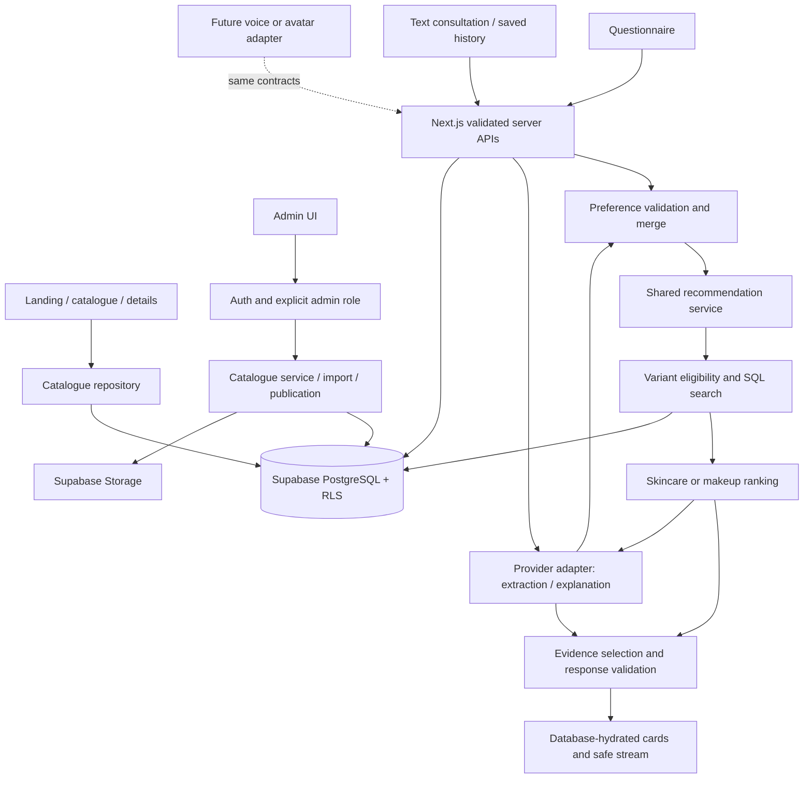
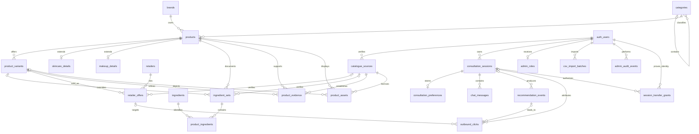

# Architecture and PostgreSQL design

**Design specification only.** Translate this into versioned, tested migrations in Milestone 2 after approval. The owner confirmed customer accounts with saved history and an initial source list containing only product names and retailer links.

## Application architecture

Use the requested Next.js App Router, React, TypeScript, Tailwind, shadcn/ui primitives where useful, Motion for React, Supabase PostgreSQL/Auth/Storage, server-side Route Handlers, interchangeable LLM provider, and Vercel. Pin supported stable package versions together at kickoff; this document does not assume a future patch version.

One deployable modular monolith. Modules: `catalogue`, `consultations`, `accounts`, `recommendations`, `ai`, `retailers`, `admin`, `analytics`, and shared `contracts`. UI components never construct SQL or call the LLM directly. Search/ranking/explanation orchestration lives outside HTTP handlers so later clients reuse it.

Server Components render public catalogue content; small client islands own filters, shade selection, questionnaire, chat, and motion. A server-only data-access layer returns minimal DTOs and checks authorization per operation. Auth checks in a page/layout do not protect every separate action or endpoint. [Next.js data security](https://nextjs.org/docs/app/guides/data-security)

Use Node runtime Route Handlers for streaming and database/SDK compatibility. Keep private pages/responses dynamic and `private, no-store`; never share-cache user context. Public published catalogue reads may use short tagged caching; publishing/unpublishing invalidates relevant tags. Compute offer freshness on each response and recheck at outbound navigation. Route Handlers support web request/response APIs and streaming. [Next.js route handlers](https://nextjs.org/docs/app/api-reference/file-conventions/route)

Prefer Supabase in Singapore and Vercel functions colocated with the database when the selected plans permit. Vercel lists `sin1` for Singapore; verify actual settings during deployment, and review provider/CDN/logging transfers separately. [Vercel regions](https://vercel.com/docs/regions)

## Relational conventions

- UUID primary keys with database-generated defaults unless a table below declares a composite or shared primary key.
- `created_at`, `updated_at`: `timestamptz NOT NULL`, database timestamps; every mutable table gets an update trigger. Event tables only need `created_at`.
- `?` below means nullable. All other fields are NOT NULL unless explicitly noted. `FK` means enforced foreign key. Every externally supplied stable key is unique within its named namespace.
- All prices use integer minor units (`price_sgd_cents`), never floating-point money. Checks enforce `0..100000000`; input API maximum budgets are narrower. Region/currency are ISO-style uppercase text codes; MVP supports `SG` / `SGD` only.
- Controlled enum-like fields use text with CHECK constraints or referenced lookup codes. Small multi-select category characteristics may use bounded `text[]` with allowed-code checks. They are validated attributes, not separate product databases per subtype.
- Evidence freshness for formula/ingredients is explicit via `valid_until`, plus an `invalidated_at` flag. Proposed default recheck is 180 days or immediately on a known reformulation. Offer price/stock use independent observation times.
- JSONB is restricted to versioned validated preference snapshots, event summaries, evidence locators, and bounded import reports; never arbitrary unvalidated catalogue extension blobs.

## Tables: catalogue

| Table | Columns beyond timestamps | Keys and invariants |
|---|---|---|
| `brands` | `id`, `external_key`, `name`, `slug`, `website_url?`, `active` | PK id; UNIQUE external_key, slug; case-insensitive name uniqueness; safe HTTPS website if present |
| `categories` | `id`, `code`, `name`, `kind` skincare/makeup, `parent_id?`, `active`, `sort_order` | PK id; UNIQUE code; self FK parent RESTRICT; root/child same kind; no cycles; product assignment only to active leaf category |
| `products` | `id`, `external_key`, `brand_id`, `category_id`, `name`, `slug`, `description`, `status` draft/published/archived, `revision`, `published_at?` | PK id; UNIQUE external_key, slug; FKs brand/category RESTRICT; revision ≥1; slug stable on rename; publication validates complete aggregate |
| `product_variants` | `id`, `external_key`, `product_id`, `sku?`, `label`, `shade_name?`, `shade_family?`, `swatch_hex?`, `undertone?`, `size_value?`, `size_unit?`, `pack_count`, `formulation_code?`, `active`, `sort_order` | PK id; UNIQUE external_key, `(product_id,sku)` for non-null SKU, `(id,product_id)` for composite FKs; parent FK RESTRICT; size >0 if supplied, unit required with size; pack_count ≥1; hex CHECK; shade properties need field evidence, no implied exact match |
| `skincare_details` | `product_id`, `skin_types[]`, `textures[]`, `formulas[]`, `cosmetic_goals[]`, `fragrance_status` declared_free/present/unknown | PK/FK product; exactly one type-specific detail row for published skincare; empty lists mean unknown/no supported values, not “all” |
| `makeup_details` | `product_id`, `finishes[]`, `coverages[]`, `formulas[]`, `properties[]`, `fragrance_status` declared_free/present/unknown | PK/FK product; exactly one row for published makeup; category applicability rules, e.g. coverage not required for mascara; finishes distinct from shades |
| `ingredients` | `id`, `inci_name`, `normalized_name`, `aliases[]` | PK id; UNIQUE normalized_name; aliases admin-reviewed, not LLM-created; alias collisions rejected or explicitly resolved |
| `ingredient_sets` | `id`, `external_key`, `product_id`, `variant_id?`, `scope_label`, `completeness` complete/partial/unknown, `normalization_status` complete/needs_review, `raw_inci?`, `source_id?`, `verified_at?`, `valid_until?`, `invalidated_at?`, `is_current` | PK id; UNIQUE external_key; product FK; composite `(variant_id,product_id)` FK when variant-scoped; UNIQUE `(id,product_id)`; at most one current product-wide set and one current set per variant via partial UNIQUE indexes; complete requires raw INCI, source and verification; a product-wide set must be verified to apply to every inheriting variant |
| `product_ingredients` | `ingredient_set_id`, `ingredient_id`, `position`, `presence` definite/may_contain | Composite PK `(ingredient_set_id,ingredient_id)`; FKs set CASCADE, ingredient RESTRICT; UNIQUE `(ingredient_set_id,position)`; position ≥1; union “may contain” lists are retained, not guessed per shade |
| `retailers` | `id`, `external_key`, `name`, `slug`, `allowed_hosts[]`, `approved_affiliate_hosts[]`, `active` | PK id; UNIQUE external_key, slug; normalized exact hostnames; no arbitrary suffix matching |
| `retailer_offers` | `id`, `external_key`, `variant_id`, `retailer_id`, `region`, `currency`, `price_sgd_cents?`, `tax_included?`, `product_url`, `affiliate_url?`, `affiliate_approval_ref?`, `affiliate_approved_at?`, `affiliate_expires_at?`, `availability` in_stock/out_of_stock/discontinued/unknown, `price_verified_at?`, `availability_verified_at?`, `source_id?`, `active`, `is_sponsored`, `sponsor_label?` | PK id; UNIQUE external_key, `(retailer_id,variant_id,region)` for one standard offer per merchant/variant; FKs RESTRICT; non-null price requires currency SGD, source, price verification; affiliate requires approval; sponsored requires disclosure label; conditional/member/coupon offers excluded from beta price logic |
| `catalogue_sources` | `id`, `external_key`, `url`, `publisher`, `source_kind` brand/retailer/packaging/permission, `accessed_at`, `locator?`, `verified_by`, `review_status` pending/verified/rejected | PK id; UNIQUE external_key; verifier FK auth.users RESTRICT; sources may recur over time; human-approved provenance, no automated retailer crawling |
| `product_evidence` | `id`, `external_key`, `product_id`, `variant_id?`, `field_path`, `verified_value` JSONB, `source_id`, `verified_at`, `valid_until`, `invalidated_at?`, `is_current` | PK id; UNIQUE external_key; product FK; composite variant/product FK; source FK; current UNIQUE product/field for product-level evidence and variant/field for variant evidence; published evidence only supports a current equal stored value; clinical claims excluded |
| `product_assets` | `id`, `external_key`, `product_id`, `variant_id?`, `storage_path`, `alt_text`, `sort_order`, `source_id`, `rights_basis`, `rights_reference`, `rights_expires_at?`, `approved` | PK id; UNIQUE external_key; composite variant/product FK; source FK; UNIQUE storage_path; approved image rights required before public use; no real product photo synthesized as a verified product image |

The extra source/evidence/asset/ingredient-set tables are deliberate: the brief requires verified claims, variant-specific ingredients, image rights, and reviewable data. No separate makeup subtype tables or shade prediction engine are needed.

Ingredient fallback: choose a current variant-specific set if present; otherwise a verified product-wide set that explicitly covers that variant's formula/region. An unknown or partial override prevents falling back to a complete parent list. Never combine partial sets into an invented complete formula. See matching rules for exclusion semantics.

## Tables: consultations, accounts, operations

| Table | Columns beyond timestamps | Keys and invariants |
|---|---|---|
| `consultation_sessions` | `id`, `owner_user_id`, `title?`, `mode` temporary/saved, `status` active/closed, `last_active_at`, `expires_at`, `saved_at?`, `preferences_version`, `privacy_notice_version` | PK id; owner FK auth.users CASCADE; expires after creation; saved requires a non-anonymous identity and saved_at; title max 100 chars, neutral default rather than inferred medical detail |
| `consultation_preferences` | `session_id`, `schema_version`, `revision`, `preferences` JSONB | PK/FK session CASCADE; one canonical snapshot per session; bounded JSON schema and allowed categories/values; optimistic revision guard |
| `chat_messages` | `id`, `session_id`, `turn_id`, `sequence`, `role` user/assistant, `content_text`, `recommendation_snapshot?` JSONB, `state` pending/complete/interrupted/failed, `client_message_id?`, `preference_revision` | PK id; session FK CASCADE; UNIQUE `(session_id,sequence)`, partial UNIQUE `(session_id,client_message_id)`; content and turn limits; bounded server-validated historical result snapshot only for assistant rows; no hidden chain-of-thought/system prompts stored; only backend can write assistant messages |
| `recommendation_events` | `id`, `session_id?`, `turn_id?`, `request_id`, `preference_revision`, `algorithm_version`, `catalogue_revision`, `result_summary` JSONB, `reason_codes[]`, `provider?`, `model?`, `input_tokens`, `output_tokens`, `duration_ms`, `outcome` | PK id; session FK SET NULL; UNIQUE request_id; bounded server-generated result summary with parent/variant/offer IDs, reason codes and rank; no raw prompt or ingredient-exclusion free text |
| `outbound_clicks` | `id`, `session_id?`, `recommendation_event_id?`, `offer_id?`, `source` catalogue/detail/chat, `used_affiliate`, `request_id` | PK id; session/event/offer FKs SET NULL; UNIQUE request_id; no email/full IP/complete referrer URL; navigation measurement, not a sale |
| `admin_roles` | `user_id`, `role` owner/editor, `granted_by?` | PK/FK auth.users RESTRICT; grantor FK; no self-assignment; only owner-authorized privileged operation can change roles; customer login never implies administrator |
| `csv_import_batches` | `id`, `created_by`, `kind` intake/catalogue, `schema_version`, `file_sha256`, `storage_path`, `status` staged/invalid/ready/committed/needs_enrichment, `report` JSONB, `row_count`, `committed_at?` | PK id; creator FK RESTRICT; UNIQUE `(created_by,file_sha256,schema_version,kind)`; immutable committed report; intake may lack normalized product fields and cannot publish |
| `admin_audit_events` | `id`, `actor_id`, `action`, `entity_type`, `entity_id?`, `change_summary` JSONB, `request_id` | PK id; actor FK RESTRICT; append only; no consultation text/secrets; record role, import, offer and publication changes |
| `rate_limit_buckets` | `bucket_key`, `window_start`, `request_count`, `reserved_tokens`, `expires_at` | Composite PK `(bucket_key,window_start)`; private schema; atomic upsert/locking; TTL cleanup; user/session and short-lived keyed network hash, never raw IP; supports global spend reservations |
| `session_transfer_grants` | `id`, `session_id`, `guest_user_id`, `token_hash`, `destination_user_id?`, `expires_at`, `consumed_at?` | PK id; session/guest FKs CASCADE; destination FK SET NULL; UNIQUE token_hash; TTL 10 minutes; backend-only, one-use transaction; destination set only after verified account callback bound to initiating browser |
| `analytics_daily` | `day`, `event_type`, `kind` skincare/makeup/all, `event_count` | Composite PK `(day,event_type,kind)`; nonnegative count; aggregated event types only; no customer/session/text fields |

Customer email and authentication state stay in `auth.users`; no duplicate customer profile table is needed for this scope. The app does not expose the Auth table through public catalogue APIs. Magic-link email delivery and redirect allowlists must be configured before account acceptance testing.

## Entity relationship diagram

`auth_users` denotes Supabase `auth.users`. `rate_limit_buckets` and `analytics_daily` have no entity FKs because they represent expiring enforcement scopes and identifier-free aggregates respectively. Conditional XOR between category detail tables, publication completeness, and evidence validity require additional constraints/triggers; ER lines alone cannot express them.

## Constraints, transactions, and indexes

**Publication transaction:** lock the parent, increment revision, validate active brand/leaf category, exactly one corresponding details row, at least one active variant, approved primary asset, verified core identity/description, current evidence for asserted properties, and valid data shapes. Offers/complete ingredients may be absent, but the UI must disclose this and matching must exclude the product where those facts are required. Status changes become visible atomically; a product with insufficient facts stays draft.

**Family integrity:** deferred constraint triggers enforce skincare/makeup detail compatibility, category tree integrity, evidence equality to current fields, and complete ingredient-set requirements. A controlled update can edit all related rows in one transaction. Reject category kind changes for categories with products; move products through an explicit reclassification workflow.

**Deletes:** archive products/variants and disable offers by default. Parent FK RESTRICT prevents accidental catalogue loss; cleanup deletes dependent assets/evidence/details explicitly. Deleting a consultation CASCADEs messages/preferences and nulls raw analytical links. Deleting a customer cascades owned sessions; scrub/unlink remaining event references. Admin-role/audit FKs intentionally block deleting privileged identities until role reassignment and an audited retention decision.

**Indexes:** PK/UNIQUE constraints supply their own indexes. Add `(guest_user_id)` and `(expires_at)` on session transfer grants, `(destination_user_id)` where non-null; add `(brand_id,status)`, `(category_id,status)`, and `(status,published_at,id)` on products; `(product_id,active,sort_order,id)` on variants; `(variant_id,active,region,currency,price_sgd_cents)` and `(retailer_id)` on offers; `(product_id)` and `(source_id)` on evidence/assets/sets as appropriate; reverse `(ingredient_id,ingredient_set_id)` on product ingredients; `(owner_user_id,last_active_at DESC,id)` and `(expires_at)` on sessions; `(session_id,sequence)` on messages; `(created_at)` and `(session_id,created_at)` on recommendation/click events; `(offer_id)` and `(recommendation_event_id)` on clicks; `(status,created_at)` on imports. Index other FKs not covered by a leftmost prefix, including category parent, audit actor and import creator.

Search begins with parameterized case-insensitive name/brand matching across at most 80 parents. Add a maintained weighted search vector plus GIN only if measured plans justify it; embeddings are unnecessary. Do not index every low-selectivity attribute array speculatively. Use EXPLAIN on representative expanded-variant data before adding more indexes. Use a serverless-compatible Supabase connection path/pooler for transactions; never open unbounded per-request direct connections.

## Authorization and RLS policy design

Enable RLS on every application table; use explicit grants as well as policies. Supabase service credentials bypass RLS, and views require care to preserve caller policies; public views must use `security_invoker` and safe column grants or be unexposed. [Supabase RLS](https://supabase.com/docs/guides/database/postgres/row-level-security)

| Resource | Public / logged-out | Customer, including technical anonymous identity | Editor/owner | Backend privileged operations |
|---|---|---|---|---|
| Published catalogue | SELECT safe fields on published products and visible children | Same | SELECT all; authorized catalogue CRUD | Publication/import transactions only after admin validation |
| Sources, rights, import files, review/audit fields | No access | No access | Authorized read/edit except immutable audit | Narrow import/audit operations |
| Sessions/preferences | No access | Own unexpired sessions only; controlled create/update/delete | Own sessions only; no general customer-history access | Verified guest transfer and expiry/deletion |
| Messages | No access | SELECT own; INSERT own user messages within bounds; cannot fabricate assistant role or mutate completed content | Same customer rule | Assistant writes after verified session ownership |
| Recommendation/click events | No raw access | No raw access or arbitrary inserts | Aggregate metrics only | Validated server inserts; retention cleanup |
| Admin roles | No access | No membership change | Own membership read; owner-managed grants via protected server path | Bootstrap/grant after owner authorization |
| Rate buckets / transfer grants | No access | No direct access | No direct access | Atomic counters, verified one-use transfer and cleanup |
| Daily aggregates | No access | No access | Read bounded dashboard projection | Append/update counts and retention |

Public catalogue policies require published parent + active variant + active brand/category; offer policy also checks active retailer/offer. Public readers receive DTO fields, never affiliate approval documents, staff identities, internal notes, or private source snapshots. Use column privileges/projection functions to avoid confusing row visibility with field secrecy.

Session ownership predicate: `auth.uid() = owner_user_id AND expires_at > now()`; child policies use an indexed session EXISTS predicate. INSERT/UPDATE require matching `WITH CHECK`, immutable owner/mode except protected save/transfer operations, and database-enforced field/row limits. Admin helper reads `admin_roles` through a narrowly scoped SECURITY DEFINER function with fixed empty search path, no dynamic SQL, and explicitly limited execute grants; no recursive role policy and no user-editable metadata authorization.

Guest consultations may use Supabase anonymous sign-in: it creates an internal Auth user and uses the `authenticated` database role, so that role alone must never confer admin privileges. Account and anonymous endpoints must avoid shared rendering caches. [Supabase anonymous sign-ins](https://supabase.com/docs/guides/auth/auth-anonymous)

Use the caller's verified JWT for ordinary catalogue administration and owner-scoped reads/writes so RLS remains active. A small server-only privileged repository handles assistant messages, telemetry, identity transfers, admin grants and cleanup. Every privileged operation rechecks its authenticated actor, session ownership/expiry, fixed action, and input shape; service credentials are not a substitute for those checks and are never sent to browser/model. Use same-origin/CSRF protections for cookie-authenticated mutations. Test direct REST/RPC access as well as app routes.

## Accounts and saved history

- Proposed method: passwordless email link/OTP; no social providers or passwords in beta. Customer identity and admin role are distinct. Admin login uses the same Auth service plus role checks and MFA before privileged writes.
- Guests browse without Auth; create an anonymous identity only when a consultation starts. Keep Auth tokens in secure server-managed cookies where compatible with the chosen SSR flow. No secrets in URLs or analytics.
- New unsaved sessions expire after 24 hours from creation. Signed-in users explicitly choose “Save conversation”; saved sessions expire after 90 days of inactivity, clearly displayed. Saved content includes messages and the canonical preference snapshot.
- For a new identity, link the anonymous identity to an email using a verified Auth flow. For an existing account, create a one-use, short-lived server transfer grant bound to the verified guest session and destination sign-in; store only its hash in `session_transfer_grants`. Require both proofs, an explicit save action, expiry, and single-use consumption in a transaction. Never transfer by session UUID alone.
- On resume, preserve past messages and their validated result snapshots as history, mark old cards as historical, and rehydrate/revalidate current products/offers. History uses the private message snapshot rather than depending on 30-day analytics retention. Archived products show unavailable; a saved price is never presented as current.
- Delete a conversation immediately from serving stores. Delete-account action reauthenticates, deletes saved/guest sessions and Auth identity, signs out, and explains any documented backup retention. No admin ability to browse histories is implied.

## Retention and operations (proposed policy)

| Data | Proposed lifetime | Enforcement |
|---|---|---|
| Unsaved guest or signed-in session | 24 h from creation | Deny access at expiry; daily deletion, up to 24 h cleanup lag |
| Saved consultation and preferences | 90 days since last activity or earlier deletion | UI expiry notice; indexed daily cleanup |
| Orphaned anonymous Auth identities | Delete after session cleanup plus 7 days | Scheduled privileged cleanup with no active session/role check |
| Raw recommendation/click events | 30 days | Strip session links on deletion; aggregate counts only thereafter |
| Daily aggregate counts | 12 months | No transcript, email, or stable user identifier |
| Import intake/enrichment sources | Until resolved, max 90 days | Staff reminders; private storage; renew explicitly if still needed |
| Uploaded full CSV files | 7 days after commit or abandonment | Private storage deletion; retain bounded error/audit summary |
| Admin audit summaries | 180 days | Scheduled pruning; exclude private chats and secrets |
| Session transfer grants | 10 minutes or consumption | Invalidate immediately on use; daily cleanup |
| Rate/spend buckets and network hashes | ≤48 h for rate keys; daily spend totals 30 days | TTL cleanup; rotated keyed network hash |

Retention numbers are product proposals. Provider prompt retention, backup expiration and email-provider retention must be checked and disclosed separately; app deletion cannot promise immediate erasure from every backup. Use `analytics_daily` for date/event/category counts without customer FKs. Suppress very small category cohorts in displayed breakdowns; expose overall totals instead.

Local, staging, and production have separate data/secrets. Synthetic test fixtures never become live catalogue records. Use protected preview access, schema migrations in CI, environment-bound Auth redirects, approved image hosts, structured metadata-only errors, monitoring and alert thresholds. Scheduler performs expiry/aggregation and due-review reminders; it does not scrape retailers. Keep an LLM kill switch, versioned ranking rules, database backups appropriate to the selected plan, and an exercised rollback path.

## Migration sequence after approval

1. Controlled values, brands/categories/products/variants, details, constraints and indexes.
2. Sources/assets/ingredients/sets/evidence/offers and publication transaction.
3. Customer/session/preferences/messages, saved-history transfer support, RLS and grants.
4. Admin roles/imports/audit, event/aggregate/rate tables and narrow RPCs.
5. Storage policies, retention scheduling, test-only fixtures, fresh-database and upgrade verification.

No migration is executed during this planning phase.
