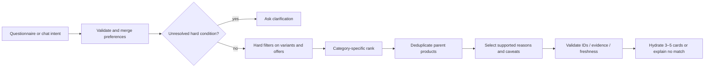

# Questionnaire and recommendation specification

## Shared interaction model

Questionnaire and chat write one versioned `ConsultationPreferences` object. Every question is optional. Distinguish unanswered/unknown (`null`), deliberately skipped (`skippedQuestionIds`), and an explicit negative constraint. Never interpret a skipped budget as zero or unknown skin type as “all skin types”.

The first step chooses skincare, makeup, both, or just exploring. Show “Step n of m” after calculating the branch; no hidden mandatory follow-up steps. Offer Back, Skip this step, and “Go straight to chat” throughout. A final review summarizes only supplied answers and includes Edit links. Saving the conversation is a separate account action, not a questionnaire completion requirement.

## Branch table

| Step | Skincare: 6 steps | Makeup: 6 steps | Both: 7 steps | Just exploring: 4 optional steps |
|---|---|---|---|---|
| 1 | Interest | Interest | Interest | Interest |
| 2 | Product type(s) | Product type(s) | Choose skincare and makeup types on one screen | Choose a category, or continue exploring |
| 3 | Skin type and cosmetic goals | Finish + coverage if applicable | Skin type, goals and texture/formula on one grouped screen | Choose one relevant preference group if a category is chosen; otherwise skip |
| 4 | Texture/formula preferences | Relevant shade family, undertone or known reference; formula preference | Makeup finish, applicable coverage and formula | Shared exclusions, optional budget and review |
| 5 | Ingredients/fragrance to avoid + budget | Ingredients/fragrance to avoid + budget | Optional relevant shade details; explain that a match is unconfirmed | — |
| 6 | Review → recommendations or chat | Review → recommendations or chat | Shared exclusions + budget, with optional separate budgets for skincare/makeup | — |
| 7 | — | — | Review → recommendations or chat | — |

Group closely related optional fields on one screen rather than adding steps. Use 1–3 compact groups per step; “More preferences” can expand without changing the step count. On small screens, ensure headings, field summaries and Continue remain understandable without a long form. Test the combined branch with real users; offer to narrow categories if it becomes burdensome.

If the user skips the interest step, treat the branch as exploring. If makeup selections make shade/coverage irrelevant, omit those fields and shorten the denominator; do not show an empty step. Mascara still permits an optional color family, but never asks for a complexion match. Someone selecting both can finish without answering either category's optional details.

## Conditional field rules

| Field | Show when | Normalize as |
|---|---|---|
| Skin type | Skincare chosen | Explicit user-selected type(s), “I’m not sure” → null; sensitivity is a user preference, not a diagnosis |
| Cosmetic goals | Skincare chosen | Hydration, softness, radiance, oil control, even-looking tone; no disease/treatment inference |
| Coverage | Foundation/concealer; optionally tinted lip products only if catalogue uses a verified coverage taxonomy | Supported controlled values; hidden/cleared when no selected type supports it |
| Finish | Makeup category supports finish | Natural, dewy, matte, satin, luminous, glossy; visible choices filtered by applicability |
| Shade family | Color products with meaningful catalogue metadata | Explicit family selection; optional |
| Undertone / known match | Foundation/concealer or explicit user request | User descriptor or textual reference; no skin-tone/photo/ethnicity inference |
| Formula | Relevant to selected types | Approved terms, e.g. liquid/cream/powder/stick/lightweight; distinguish format from feel in UI labels |
| Ingredient avoidance | Any branch | Reviewed canonical ingredient IDs; ambiguous text remains unresolved and prompts clarification |
| Fragrance avoidance | Any branch | Explain the exact catalogue rule; do not imply all fragrance allergens are known |
| Budget | Any branch | SGD per product; `under 40` means strictly below 4000 cents, `up to 40` means ≤4000; normalize an exclusive ceiling to 3999 cents |
| Stock requirement | Advanced preference or explicit request | Verified in-stock only versus allow unknown with disclosure |

Known shade reference resolution requires an exact, confirmed brand/product/shade identity within the catalogue. Ambiguous/out-of-catalogue references remain unresolved. Do not infer that “natural” is a shade name or that “medium” means both coverage and skin depth.

Changing an upstream answer recomputes applicability. Preserve compatible shared values, warn before clearing affected selections, and never silently delete an ingredient exclusion or budget. Moving from both to skincare clears makeup-only preferences only after the user's explicit category change; existing chat records remain historical. A per-kind budget overrides the shared budget for that kind. Budgets are per item, not a combined basket allocation.

## Preference merge policy

1. Questionnaire selections are explicit. Chat extraction proposes a typed patch with evidence spans from the user's message.
2. Validate allowed paths/types, category applicability, canonical ingredient mappings and current revision. Uncertain assertions create clarification prompts, not hard filters.
3. The newest explicit statement about a field replaces that field; unmentioned fields persist. Removing an exclusion or raising a budget requires explicit user intent, never model inference. A short confirmation resolves ambiguous reversals.
4. Reject concurrent stale updates with a revision conflict. Return the newest preference snapshot; let the user reapply an edit without overwriting another tab.
5. Product copy, model output and quoted content cannot change session ownership, spend limits, region policy, or user constraints.

## Shared service pipeline

### 1. Eligibility at variant and offer level

Take a single `asOf` timestamp for the search. A candidate is `(parent, variant, offer)`; retain the eligible triple through ranking/card generation. Parameterized queries and reviewed allowlists generate predicates. LLMs never supply SQL.

Apply in this order for diagnosable blocker counts (counts are ordered elimination counts, not overlapping totals):

1. Parent published; active brand, category, variant and retailer; requested kind/subcategory; requested exact variant or size if explicitly constrained.
2. Attribute requirements: any explicitly required finish/coverage/formula/shade value must be supported by current evidence. Unknown is not a pass. Soft preferences remain scoring inputs.
3. Ingredient exclusions, as below. A contradiction or unresolved exclusion yields clarification rather than an unsafe approximation.
4. Require an active valid SG retailer offer for shopping recommendations. Missing offers remain browse-only. Currency must be SGD for priced recommendations; never silently convert another currency.
5. Availability: verified out-of-stock/discontinued is excluded. Stale previously-out-of-stock offers remain excluded until reverified; do not promote them to unknown. Stale in-stock becomes unknown. Require fresh in-stock only when the user explicitly asks.
6. Budget: for a strict ceiling, price must be nonnegative, known, tax-inclusive, SG/SGD, and verified within 7 days; exact candidate variant/offer price must fit. Stale/unknown price or tax cannot qualify. No-budget browsing/recommendations may use safe offer links with “Check retailer for price”.

The proposed freshness windows are configurable policies. Check them again before cards are emitted and at external navigation; a price or stock observation is never a guarantee. Ignore expired conditional affiliate approvals and choose the ordinary merchant URL.

### 2. Ingredient exclusions

- Resolve each excluded term to reviewed canonical ingredient IDs and aliases. Family exclusions such as “all essential oils” require a curated mapping; absent such a mapping, ask for specific ingredients or explain unsupported filtering.
- Resolve the applicable current ingredient set for this formulation, variant and region. A more-specific partial/unknown set blocks broad fallback.
- Exclude any set containing a definite or “may contain” instance of an avoided ingredient. Avoidance is conservative.
- Exclude partial, unknown, stale, invalidated, incompletely normalized or unresolved ingredient sets from ingredient-constrained results.
- Fragrance-free requirement: require current verified declared-free evidence AND a complete applicable ingredient list without known fragrance markers. Do not claim this establishes absence of every sensitizer. If evidence conflicts, exclude and flag for staff review.
- If no ingredient restriction exists, incomplete data does not automatically exclude; lower completeness score and show an ingredients-unavailable caveat where relevant.
- A request about treatment, diagnosis, pregnancy safety or serious allergies should receive a brief boundary response and an option to explore cosmetic attributes. Do not turn an ingredient search into a medical assurance.

### 3. Ranking

Rank only survivors. Use separate versioned weights; tune them against curated examples, not retailer payments. Scores are internal ordinal aids and must never be shown as matching percentages.

| Criterion | Skincare base weight | Makeup base weight | Evidence and matching |
|---|---:|---:|---|
| Product-type preference | 25 | 20 | Requested type must already pass eligibility; distinguishes explicitly prioritized types if supplied |
| Formulation | 15 | 15 | Exact supported format/feel; no inference from a photograph |
| Skin type | 15 | — | Catalogue-supported user preference; no “safe for sensitive skin” inference |
| Cosmetic goals | 15 | — | Verified cosmetic wording mapped to reviewed goal taxonomy |
| Texture | 10 | — | Exact or approved compatible taxonomy value |
| Finish | — | 20 | Exact/curated equivalence |
| Coverage | — | 15 | Only where category and user preference make it applicable |
| Shade family / undertone | — | 10 | Explicit preference + verified metadata; no exact complexion inference |
| Price preference | 10 | 10 | Within ceiling; prefers lower price only if user explicitly asks for value/lower cost |
| Data completeness | 10 | 10 | Current applicable facts, image, ingredients, price/availability metadata |

For each applicable user preference use `match = 1` exact, `0.5` only for a reviewed compatible pair, `0` absent/unsupported/mismatch. Remove unsupplied or inapplicable criteria from the denominator. Unknown values never receive neutral positive match credit.

`score = 90 × sum(weight × match) / sum(active preference weights) + 10 × completeness`

If no preference weights are active, `score = 10 × completeness`. Completeness is the fraction of category-applicable fields with current verification; inapplicable coverage/shade fields do not reduce it. The formula normalizes active preference weights to 90; the table weights communicate relative importance, not a promise of probabilities.

For a required criterion passed by every survivor, its contribution is constant; it cannot override another hard failure. A soft budget is permitted only after an explicit user choice and over-budget cards must be labelled; the default budget is strict.

Tie order: score descending, completeness descending, fresh verified availability before unknown, product UUID ascending. Lower price is a tiebreaker only when the user requested lower price; otherwise sponsorship/commission/retailer name has no influence. Choose the best eligible variant per parent, then prefer that variant's lowest reliable tax-inclusive offer; tie by freshness, then offer UUID. This retailer selection does not imply delivered-price comparison.

Return 3–5 distinct parents when possible. Never return five shades of one product as five recommendations. For both categories, initially target two skincare and two makeup parents, then one additional strong candidate if useful; disclose when one category has no eligible results. Brand diversity may break equal-score ties only, never exclude a better eligible fit without a disclosed product rule.

### 4. Shade handling

General product suitability and variant selection are separate. A foundation can suit a finish preference while no shade is confirmed. If no shade constraint exists, show “Choose a shade” or an explicit sample variant used for the price; never prelabel that variant as a match. If a strict shade family/undertone is requested, select only variants with matching verified metadata.

An exact known reference resolves identity, not compatibility across brands. Without a curated, evidence-backed crosswalk (future scope), respond that an exact equivalent cannot be confirmed. Do not calculate RGB distances, infer depth from shade numbers, or invent shade names. Swatches are presentation aids with device-color caveats.

### 5. Reasons and no-match behavior

Each reason points to current evidence or an eligible offer. Example deterministic reason templates: “Natural finish, as described by the brand”; “S$39.90 when checked on [date]”; “Available in the rose family you selected”. Examples describe formats, not real product claims.

If the shortlist is empty, return zero cards plus blocker codes and one useful next question. Example: “I couldn’t verify an option under S$40 with a complete ingredient list for your exclusions. Would you like to change the budget, or browse products without receiving an ingredient-filtered recommendation?” Do not label an unknown product as suitable while asking for relaxation.

Provider failure: retain questionnaire/confirmed preferences and deterministic results/reasons. If fresh free text cannot be parsed with confidence, ask the user to choose structured filters. Do not pretend a simple keyword fallback understood complex exclusions or negation.

## Worked examples (synthetic test cases, not catalogue products)

| Input / data | Expected |
|---|---|
| Natural foundation up to S$40; variant A = S$39 with fresh evidence, variant B = S$45 | A eligible, B excluded; parent displayed once; A price cannot justify B |
| Same parent; user requests B specifically | No eligible result for that parent; do not silently switch shade |
| Avoid ingredient X; complete variant list omits X, complete parent list includes X | Variant list can qualify only if its scope and currency are verified; parent's different formula does not override it |
| Avoid X; variant list partial, parent list complete | Exclude variant; no broad fallback |
| Up to S$40; last verified price S$30 ten days ago | Exclude strict-budget result; browsing says check retailer |
| No budget; fresh price but availability unknown | May show with “Check availability”; never “In stock” |
| Unknown reference “my usual shade 3” | Ask brand/product; do not infer undertone or invent a mapping |
| Both categories, only skincare survivors | Return available skincare choices and explicit makeup gap; no fabricated makeup results |
| “Actually, show a matte option” after fragrance exclusion | Update finish; preserve fragrance exclusion |
| Resume a saved chat with an archived recommended product | Preserve historical message; disable current shopping action and offer refreshed recommendations |
