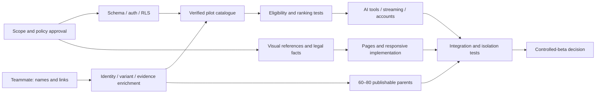

# Delivery plan, workload and acceptance gates

## Estimate and scheduling assumptions

One experienced engineer owns frontend, backend, UX implementation, integration, tests and deployment. Work proceeds after approval, with review turnaround within two working days and credentials/assets available at the relevant milestone. These are planning estimates, not elapsed-time guarantees or a promise of production readiness.

**Baseline: 296 engineering hours**. This includes a low-end **24-hour increment for customer accounts and saved history** beyond the original brief's admin-only authentication. Add **40–56 hours** for integration defects, visual iteration, account/email edge cases and data-model adjustment: **336–352 hours total**. Teammate curation is separate.

At 40 focused hours/week, the baseline is 7.4 weeks and the full allowance is 8.4–8.8 weeks. An eight-week delivery requires roughly 42–44 focused hours/week or successful scope/efficiency tradeoffs. A six-week controlled beta is a stretch, averaging about 49 baseline engineering hours/week before contingency. Do not conceal the effect of saved history or missing product metadata on the original 6–8 week target.

Recommend planning an eight-week controlled-beta attempt with a decision checkpoint at the end of Week 2. If data or critical paths slip, move the date or explicitly reduce the initial beta scope; never drop constraint, privacy, authorization or link-integrity tests to meet a date.

## Prioritized backlog

P0 is required for the approved controlled beta. Dependencies refer to backlog IDs; detailed implementation subissues can be created after scope approval. Effort includes local verification but no major requirements change.

| ID | Milestone | Priority | Deliverable | Hours | Dependencies / acceptance |
|---|---|---|---|---:|---|
| B01 | M1 | P0 | Next.js/TS/Tailwind project and module boundaries | 8 | Approval; lint/type/build baseline |
| B02 | M1 | P0 | Approved visual references, tokens, accessible primitives | 12 | Reference images or explicit written-direction approval; design review |
| B03 | M1 | P0 | Landing and consultation UI prototypes | 16 | B02; desktop/mobile flows, loading/error examples; no fake live recommendations |
| B04 | M1 | P0 | CI and protected staging preview | 4 | B01; separate environments; secrets excluded |
| B05 | M2 | P0 | Catalogue/schema migrations, constraints, RLS and policies | 16 | B01; fresh/upgrade DB and direct access checks |
| B06 | M2 | P0 | Admin CRUD for catalogue, variants, brands/categories/offers | 18 | B05; draft/publication workflow and explicit admin roles |
| B07 | M2 | P0 | Intake queue and transactional CSV staging/import | 16 | B05–B06; row errors, stable keys, no auto-publication |
| B08 | M2 | P0 | Customer/guest ownership, saved-session schema and policies | 6 | B05; cross-customer access denied; part of account increment |
| B09 | M2 | P0 | Evidence, ingredient-set and licensed asset workflow | 8 | B05–B07; 8–12 real products fully modelled |
| B10 | M3 | P0 | Branching questionnaire and revision-safe preferences | 14 | B03/B08; all four branches, skip/back/edit/mobile |
| B11 | M3 | P0 | Variant/offer eligibility and ingredient exclusion search | 12 | B05/B09; fixed-clock filtering fixtures |
| B12 | M3 | P0 | Separate ranking, deduplication and no-match behavior | 8 | B11; reviewed expected rankings, no score display |
| B13 | M3 | P0 | Recommendation regression suite and data-gap reports | 12 | B10–B12; mandatory boundary tests pass |
| B14 | M4 | P0 | Provider adapter, extraction, five tool contracts | 16 | B11–B13; model/provider decision; strict schemas and bounds |
| B15 | M4 | P0 | Streamed chat, persistence, validation, cost/rate limits | 18 | B14; retries/cancel/provider outage/spend cap tested |
| B16 | M4 | P0 | Email sign-in, save/resume/delete, guest transfer/account UI | 10 | B08; configured email delivery; part of account increment |
| B17 | M4 | P0 | Grounding/prompt-injection evaluation and fallbacks | 10 | B14–B16; invalid IDs/claims rejected; saved cards refreshed |
| B18 | M5 | P0 | Catalogue browsing and complete typed product details | 18 | B06/B11; search/filter/sort/variants/unknowns |
| B19 | M5 | P0 | Safe outbound redirect, affiliate disclosure and clicks | 6 | B18; exact variant offer, no arbitrary redirect or false sales |
| B20 | M5 | P0 | Aggregate admin analytics and retention jobs | 6 | B15/B19; no transcript dashboard; deletion/expiry exercised |
| B21 | M5 | P0 | Responsive, keyboard, motion and visual integration | 8 | B18–B20; named viewport review |
| B22 | M5 | P0 | Privacy/terms/disclosure/contact content and metadata | 6 | Approved business/policy facts; no placeholder publication |
| B23 | M6 | P0 | Required E2E paths plus account isolation/deletion | 8 | B10–B22; executed staging evidence; part of account increment |
| B24 | M6 | P0 | Access, external-link, failure and concurrency checks | 8 | B23; direct API/RLS probes, limits and recovery |
| B25 | M6 | P0 | Accessibility/performance/visual review and fixes | 10 | B21; test devices/profiles recorded |
| B26 | M6 | P0 | 60–80 product data/readiness review | 8 | Teammate completed metadata; complete publication audit |
| B27 | M6 | P0 | Production configuration, beta deployment, rollback drill | 8 | All critical gates; provider/email/domain readiness |
| B28 | M6 | P0 | Moderated beta triage and handoff/runbook | 6 | B27; owner sign-off on observed issues |

Milestone totals: **M1 40 + M2 64 + M3 46 + M4 54 + M5 44 + M6 48 = 296 hours**. B08+B16+B23 account for the baseline 24-hour saved-history increment; their estimates are especially sensitive to provider/email migration edge cases. Contingency is not silently included twice.

P1 after core gates: richer comparison UI, automated account export, admin saved table views, extra editorial sections/assets, advanced analytics segmentation and motion refinement. Future-only: voice/avatar/mobile, commercial placement workflow, feed ingestion, checkout. No estimate assumes those future features are built now.

## Six-week sequence and weeks 7–8

The brief's six-week sequence remains the delivery order; it is not a claim that each milestone fits a 40-hour calendar week.

| Target window | Focus | Concrete exit gate |
|---|---|---|
| Week 1 / M1 | Requirements approval, system setup, design/prototypes | Approved critical screen references; usable mobile/desktop shell; no live-data claim |
| Week 2 / M2 | Schema, admin, intake/import, verified pilot catalogue | 8–12 varied parent products including shade and size overrides pass publication and RLS tests |
| Week 3 / M3 | Questionnaire and deterministic matching | Four branches complete; hard-constraint fixtures pass without an LLM |
| Week 4 / M4 | LLM tools, streaming, customer saved history | Grounded cards, outage fallback, cross-account isolation and cost controls exercised |
| Week 5 / M5 | Browse/detail/outbound/analytics/legal and polish | End-to-end shopping discovery works; 60–80 products ready for final review |
| Week 6 / M6 | Integration, device/performance tests, controlled-beta decision | All critical tests and operating checks pass; otherwise private staging continues |
| Weeks 7–8 | Expected spillover, real-user feedback, data/visual corrections | Repeat checks affected by changes; expand beta only when readiness is evidenced |

Suggested schedule at normal capacity: allow M2/M4 to spill beyond their target week and use Weeks 7–8 for completion as well as feedback. At Week 2, compare actual hours, curation throughput and unresolved provider/account issues; reforecast instead of committing to an unsupported launch date.

## Critical path and independent work

Teammate enrichment can run while engineering proceeds; this is work by the existing teammate, not an assumption of additional developers. One engineer's independent tracks still compete for the same hours. Mock fixtures unblock UI and logic tests but cannot satisfy a live-catalogue gate. Affiliate approval does not block ordinary retailer links. Missing official imagery rights, incomplete INCI or wrong variant offers can block individual products or recommendation coverage.

## Teammate workload and checkpoints

Starting state is **names and retailer links only**, confirmed by the owner. Budget **45–75 minutes per parent** for identity, attributes, ingredients, sources and image-rights review (45–100 hours for 60–80 parents), plus **3–6 minutes per additional variant** and **2–4 minutes per offer** for checks not covered in the parent pass. Additional permission outreach and hard-to-verify data are unbounded dependencies, not assumed instant.

Example planning assumption, not an observed catalogue: 70 parents, 210 variants and 210 offers. Parent work 52.5–87.5 h + 140 additional variants 7–14 h + 210 offer checks 7–14 h = **66.5–115.5 teammate hours**, before rights outreach or later rechecks. Reuse explicitly shared evidence to reduce effort; never assume all shades have identical INCI.

Data checkpoints: Week 1 select an 8–12-parent pilot spanning skincare sizes, complexion shades, color makeup, missing ingredients and multiple offers; Week 2 complete 20–30 verified parents; Week 4 reach 60–80 enriched candidates; Week 5 finish rights, publication and fresh offer review. Price/stock rechecks recur during beta and need an agreed owner and cadence.

## Automated acceptance matrix

Use unit tests for deterministic logic and schemas, integration tests against a real isolated Supabase/PostgreSQL instance for constraints/RLS/imports, provider-contract tests with deterministic fixtures, and browser E2E tests against staging. Freeze clocks for freshness tests. Synthetic product fixtures are conspicuously test-only.

| Test ID | Required case | Expected result |
|---|---|---|
| T01 | Skincare type/texture/goal/skin-type filters | Correct verified matches; makeup excluded; unknown fields receive no invented match |
| T02 | Makeup category/finish/coverage/formula | Applicability enforced; unrelated shades don't satisfy a formula constraint |
| T03 | Ingredient canonical name/alias/may-contain exclusion | All matching definite or possible-presence variants excluded |
| T04 | Missing/partial/stale INCI or unknown variant override | Excluded when restrictions apply; disclosed without exclusion requirement |
| T05 | Budget boundaries 3999/4000/4001 cents, tax unknown, stale price | Strict under versus inclusive maximum correct; unverified observations excluded |
| T06 | Expensive shade, cheaper sibling and requested size | No parent minimum-price leakage; correct eligible tuple |
| T07 | Known/unknown/ambiguous shade references | Exact identity resolution only; no guessed equivalent or complexion guarantee |
| T08 | Empty/all-filtered and both-category partial results | Zero eligible cards or honest partial set; no silent relaxation |
| T09 | Stock fresh/stale/unknown/out-of-stock/discontinued | No false in-stock claim; stale out-of-stock not promoted; strict-stock rule works |
| T10 | Missing offers/SGD mismatch/unapproved affiliate | Browse-only or excluded; ordinary safe URL when affiliate approval missing/expired |
| T11 | Five chat tools: schema, type, size and context | Valid calls work; unknown tools, SQL, extra args, broadening filters rejected |
| T12 | Invalid product/variant/evidence IDs in model output | Reject/correct/fallback; no fabricated card, price, URL or reason |
| T13 | Anonymous/customer direct admin route/action/REST/RPC | Denied; no role from editable user metadata; revoked role loses access |
| T14 | CSV duplicates, bad FK, decimal money, conflicting repeated rows, bad fields | Reviewable errors; no partial commit; replay idempotent; drafts only |
| T15 | Unsafe/broken links, credentials, scheme, Unicode host spoof, open redirect | Reject invalid destination; controlled broken-link fallback; no server-side arbitrary fetch |
| T16 | Concurrent chat/retry/disconnect/provider error/rate cap | One billable admitted turn, idempotent persistence, interruption recovery, bounded spend |
| T17 | Injection in user text/description/CSV/tool result | Cannot alter role, constraints, tool allowlist or eligibility |
| T18 | Saved histories A vs B, guest migration, expired grant | No cross-account read/write/transfer; one-use grant consumed atomically |
| T19 | Delete conversation/account, expiry and anonymized aggregates | Serving data removed; no orphaned accessible transcript; documented backup limits |
| T20 | Saved card resumed after price change/unpublication | Current facts revalidated; history labelled; unsafe stale action disabled |
| T21 | Published/read policy on joins, assets, views and child records | Draft/private fields hidden via direct access as well as UI |
| T22 | User-spoofed assistant message / telemetry | Denied; only constrained backend path can create trusted assistant/result records |
| T23 | Sponsorship/commission changed with same facts | Organic order unchanged; disclosure rendered if applicable |

Required browser journeys:

1. Skincare questionnaire → current eligible recommendations → details.
2. Makeup questionnaire → correct parent/variant recommendations → shade/size selection.
3. Free-text chat → tool execution → validated product cards; repeat with provider unavailable.
4. Product/offer selection → safe external destination; exact offer attribution without counting prefetch.
5. Admin full CSV dry run → draft commit → verification/publication → public catalogue. Names-and-links intake alone must fail publication.
6. Guest consultation → verified sign-in/save → second-device history/resume → deletion; another account denied.

Run at desktop 1440px and mobile 390px, with additional layout checks at 320/768/1024px. Use Chromium plus a WebKit/Safari pass and a real mobile keyboard check if a device is available. Record browser/version/device, fixtures, commit and failures. A screenshot check is not an executed E2E test.

## Beta release gate and rollback

Require all P0 acceptance cases, no known critical/high-impact access or constraint defects, approved data rights/policies, verified catalogue count/coverage, configured email delivery, working spend cap, privacy deletion/retention jobs, service monitoring, and a documented escalation contact. The owner reviews observed beta issues before widening access.

Release checklist: fresh staging migration, protected preview, production secrets/redirect/regions, backup/export and restoration rehearsal, safe catalogue publication, bounded beta admission, smoke tests, and a rollback drill. Use expand/contract migrations so a frontend rollback is compatible with the database. Avoid irreversible schema cleanup in the beta release. Reverting the deployment is not a substitute for data restoration.

On grounded-result or privacy failure: disable LLM/consultation admission, preserve safe public browsing where possible, investigate with metadata-only logs, correct the fault, and rerun affected critical tests before reopening.

## Verification status for this package

This is a planning phase. Application tests, SQL migrations/RLS, browser E2E, live providers, real product imports, email delivery, accessibility and deployment checks have **not been executed**. Document link/type/scope checks, if performed, are recorded separately in the planning review report and do not count as milestone acceptance.
